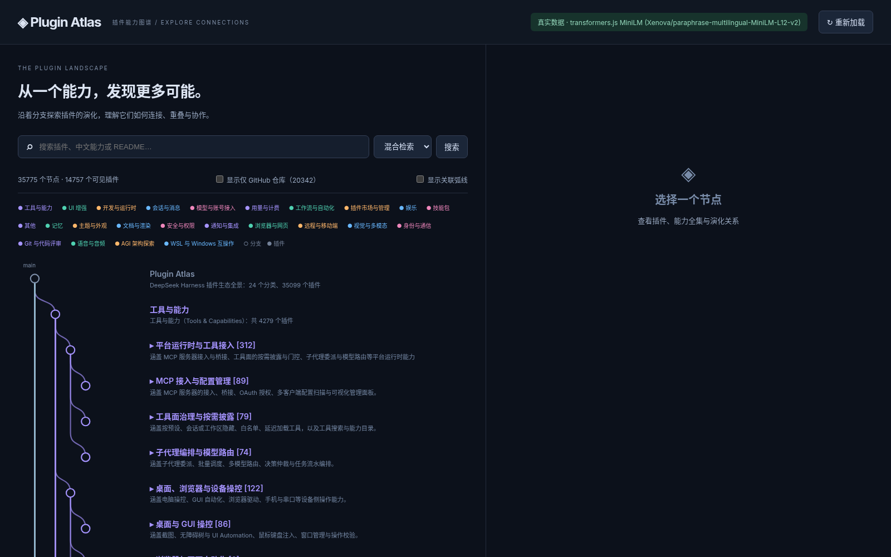
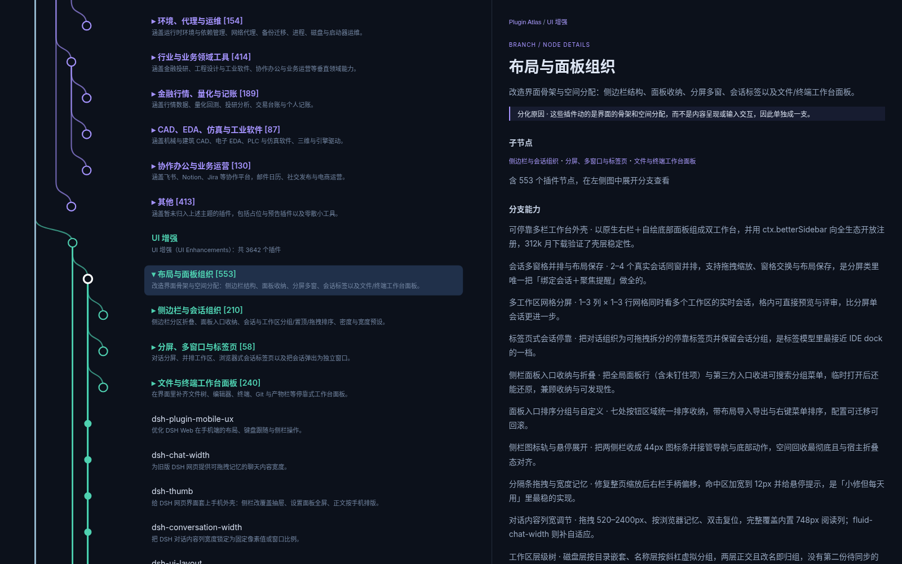

# Plugin Atlas

Plugin Atlas maps the DeepSeek Harness (dsh) plugin ecosystem. It collects plugins from public sources and organizes them into a navigable capability graph. Search the catalog by text or meaning, and explore the combined capabilities of each category and branch. The project also includes a dsh bundle for querying a local Atlas service.

## 项目是什么

Plugin Atlas 是 DeepSeek Harness（dsh）插件生态的能力图谱。从 6 个来源抓取插件：awesome-dsh-plugin 索引、npm 关键词 `dsh-plugin`、npm 关键词 `cordis-plugin`、dsh 官方按需目录、Blue-Whale-Harness 的 `repos.txt` 和 GitHub 搜索。数据组织为分类 → 分支 → 插件三级图谱，并提供每个分类和分支的能力全集。

## 功能

- 折叠大图与懒加载：首屏只绘制分类与分支，展开分支后分页加载插件。
- 全文搜索使用 SQLite FTS5 trigram；语义搜索使用 transformers.js MiniLM，首选 `Xenova/paraphrase-multilingual-MiniLM-L12-v2`。模型不可用或向量尚未完成时降级为 TF-IDF；`/api/status` 和页面显示实际生效的后端。
- `github_only` 开关控制仅来自 GitHub 的仓库，这些仓库默认隐藏。
- 疑似无关的记录标记为 `relevance: "suspect"`；过滤移出的仓库单独保存于 `data/filtered-out.jsonl`，可恢复。
- `data/capabilities/` 保存分类与分支两级能力全集。

## 截图

默认视图：



展开一个分支：



## 数据规模

以下为 v0.1.0 快照数据，日期为 2026-11-11，来自汇总和 `/api/status`：

| 指标 | 数量 |
| --- | ---: |
| 插件记录 | 35,099 |
| 默认可见 | 14,757 |
| `github_only` | 20,342 |
| 疑似无关 | 113 |
| 已过滤移出 | 38 |
| 图谱节点 / 边 | 35,775 / 43,381 |
| 分类级能力文件 | 24 |
| 索引文档 / 向量 | 74,975 / 74,975 |

去重输入 35,266 条，输出 35,137 条：其中 83 条并入市场插件，46 条为 GitHub 别名合并。

## 目录结构

```text
plugin-atlas/
├── crawler/          抓取、分析、去重、相关性过滤与能力生成脚本
│   └── README.md     数据更新说明
├── web/
│   ├── server.mjs    本地服务与 API
│   ├── public/       前端
│   ├── fixtures/     小型示例数据
│   ├── test.mjs      测试
│   ├── screenshot.mjs 截图
│   ├── start.sh      启动服务
│   ├── stop.sh       停止服务
│   └── ARCHITECTURE.md 架构说明
├── dsh-plugin/       dsh 插件
├── docs/             截图
├── CONTRACT.md       数据契约
└── data/             数据快照，不入库，从 Release 下载
```

## 环境要求

- Node.js ≥ 24（本机验证 v24.22.1）和 npm；Linux 或 macOS。
- 建议内存 ≥ 12 GB；完整数据常驻约 7 GB。`start.sh` 默认设置 `--max-old-space-size=8192`，可通过 `ATLAS_HEAP_MB` 调整。
- 首次启动时，语义模型会从 Hugging Face 下载至 `web/.models/`，约 300 MB。离线或模型不可用时自动降级为 TF-IDF。
- 可选 Chrome/Chromium：`test.mjs` 和 `screenshot.mjs` 使用 `playwright-core`。

## 安装与启动

```bash
git clone https://github.com/Trangle/plugin-atlas.git && cd plugin-atlas && (cd web && npm ci)
```

按下一节下载并解压数据，然后在仓库根目录运行：

```bash
bash web/start.sh
curl -s localhost:4380/api/status
```

默认端口为 4380，可通过 `PORT` 修改；日志写入 `logs/web.log`。完整数据首次加载到可用约 2 分钟，实测约 114 秒，可通过状态接口查看 `loading`。打开 [http://127.0.0.1:4380](http://127.0.0.1:4380)。没有 `data/`，或数据不可解析或为空时，服务回退到 `web/fixtures/` 示例数据。

停止、测试和截图：

```bash
bash web/stop.sh
(cd web && node test.mjs)
(cd web && node screenshot.mjs --out ../docs/x.png)
(cd web && node screenshot.mjs --out ../docs/x.png --expand auto)
```

## 下载数据

从 [Release v0.1.0](https://github.com/Trangle/plugin-atlas/releases/tag/v0.1.0) 下载 `plugin-atlas-data-v0.1.0.tgz` 和 `plugin-atlas-data-v0.1.0.tgz.sha256`。在仓库根目录可使用 GitHub CLI：

```bash
gh release download v0.1.0 --repo Trangle/plugin-atlas --pattern 'plugin-atlas-data-v0.1.0.tgz*'
```

或使用 curl：

```bash
curl -LO https://github.com/Trangle/plugin-atlas/releases/download/v0.1.0/plugin-atlas-data-v0.1.0.tgz
curl -LO https://github.com/Trangle/plugin-atlas/releases/download/v0.1.0/plugin-atlas-data-v0.1.0.tgz.sha256
```

验证并解压，包内顶层就是 `data/`：

```bash
sha256sum -c plugin-atlas-data-v0.1.0.tgz.sha256
# macOS: shasum -a 256 -c plugin-atlas-data-v0.1.0.tgz.sha256
tar xzf plugin-atlas-data-v0.1.0.tgz
```

包内包含 `data/plugins.jsonl`、`data/graph.json`、`data/capabilities/`、`data/readmes/`、`data/raw/`（抓取缓存）、`data/work/`（模型批处理中间文件）和 `data/filtered-out.jsonl` 等。已有服务运行时可热加载：

```bash
curl -X POST localhost:4380/api/reload
```

## 更新数据

详细说明见 [crawler/README.md](crawler/README.md)。在仓库根目录执行：

```bash
node crawler/update.mjs
node crawler/analyze.mjs --stage all
node crawler/analyze.mjs --stage relevance
node crawler/analyze.mjs --stage merge
node crawler/capabilities-category.mjs
node crawler/refresh-capabilities.mjs
curl -X POST localhost:4380/api/reload
```

`update.mjs` 增量抓取，支持 `--offline`、`--skip-github` 和 `--readme-limit N`。分析阶段也可单独指定 `--stage classify`、`branches`、`summarize`、`merge` 或 `all`。模型阶段默认使用 Codex CLI 的 `gpt-6.1-terra`；设置 `PLUGIN_ATLAS_LLM=dsh` 可改用 `dsh-run`。`SUMMARIZE_BATCH` 可调整摘要批次大小，默认 25，最小 5。需要模型的阶段会消耗对应账号额度。

恢复过滤的仓库后重新合并并刷新能力：

```bash
node crawler/relevance-restore.mjs <id...>
# 或：node crawler/relevance-restore.mjs --all
node crawler/analyze.mjs --stage merge
node crawler/refresh-capabilities.mjs
curl -X POST localhost:4380/api/reload
```

## 作为 dsh 插件安装

已在 dsh 0.2.1-rc.5 实测。`dsh-plugin/` 是 dsh 组合包：`package.json` 的 `dsh.bundle.patch` 指向 `cordis.patch.yml`，插入两个 Cordis 插件条目。

提供工具 `plugin_atlas_search(q, limit?, mode?, include_github_only?)`、`plugin_atlas_node(id)`、`plugin_atlas_status()`，以及斜杠命令 `/atlas <关键词>` 和 `/atlas-open`（在支持命令适配器的界面中使用，如 dsh web/tui）。工具通过本机 HTTP 调用 4380 端口的 `/api/status`、`/api/search` 和 `/api/node`；可通过插件 `config.baseUrl` 或环境变量 `PLUGIN_ATLAS_URL` 配置地址。服务未启动或正在加载时会返回明确提示。

本版未实现 Web 右侧栏面板，尽管 dsh 的客户端插件机制支持该能力。可用 `/atlas-open` 或 `plugin_atlas_status` 获取网页地址，在浏览器中打开。

先启动 `bash web/start.sh`，然后安装：

```bash
dsh plugin --profile headless add "file:$(pwd)/dsh-plugin"
dsh plugin --profile headless list --depth 0
dsh --profile headless --dump-config | grep -A3 plugin-atlas
dsh --profile headless "用 plugin_atlas_search 搜索 memory，列出前 3 个插件"
```

使用 web profile 时将 `headless` 换成 `web`；可用 `link:` 代替 `file:` 建立开发链接。`file:` 是复制安装，修改插件代码后需要先卸载再重新添加：

```bash
dsh plugin --profile headless remove dsh-plugin-atlas
```

无需模型和 dsh 即可自测；设置 `ATLAS_LIVE=1` 可额外查询本机服务：

```bash
(cd dsh-plugin && node test/selftest.mjs)
(cd dsh-plugin && ATLAS_LIVE=1 node test/selftest.mjs)
```

## 数据来源与免责声明

数据来自各市场公开数据、npm registry、GitHub 公开仓库及其 README。中文摘要、分类和分支归属、能力全集以及相关性判断由大模型（DeepSeek、OpenAI Codex gpt-6.1-terra）生成，可能有误或过时，请以插件原始仓库为准。插件版权归各自作者；README 原文仅用于索引展示。

## License

MIT，见 [LICENSE](LICENSE)。
