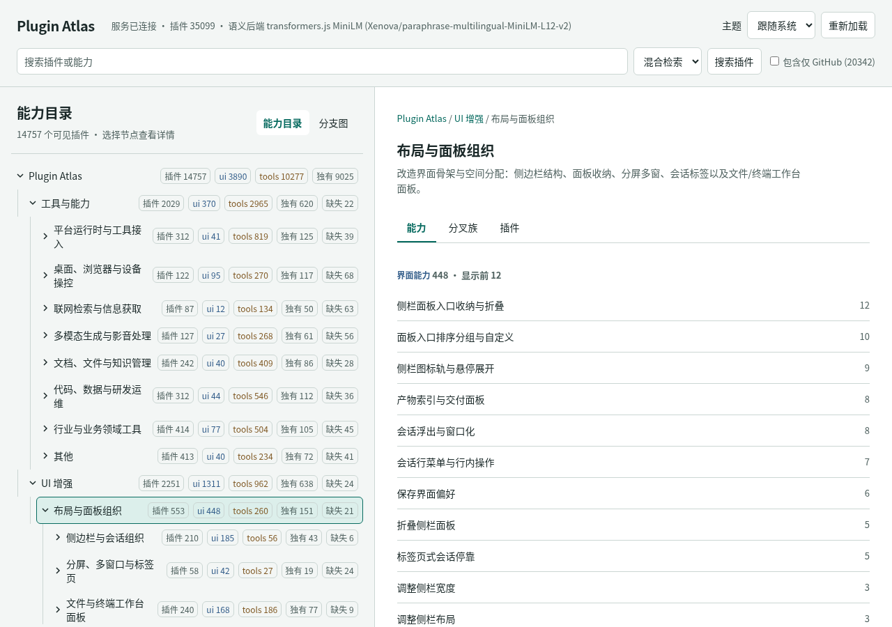
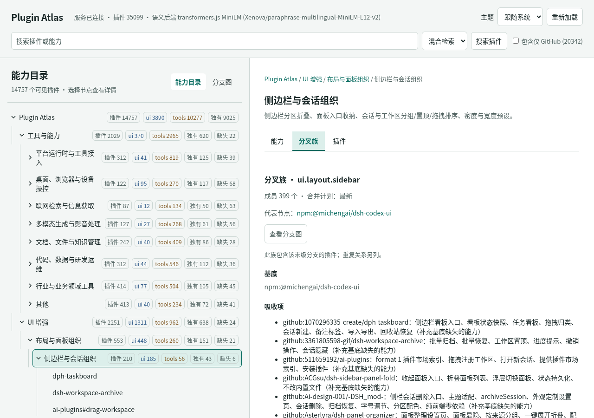
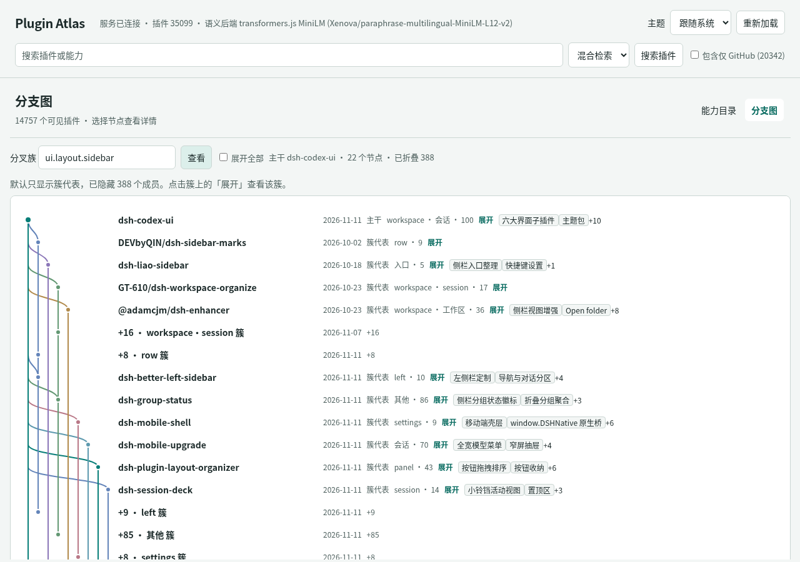
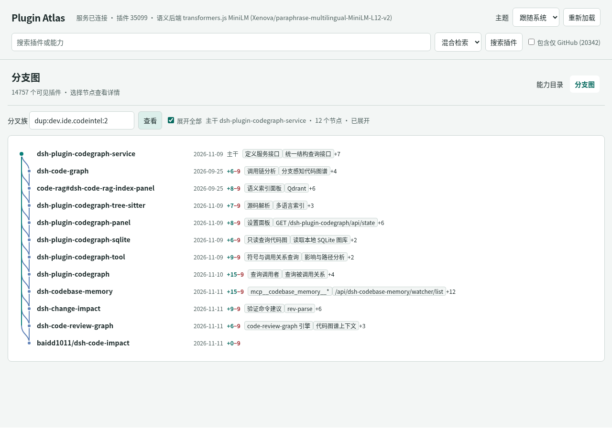
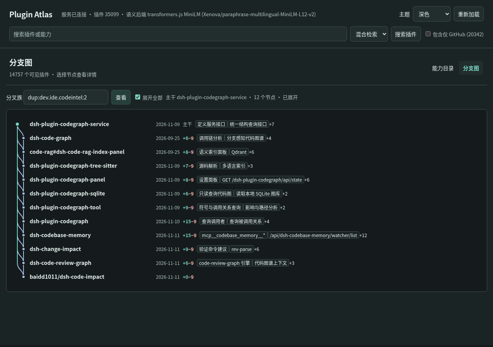
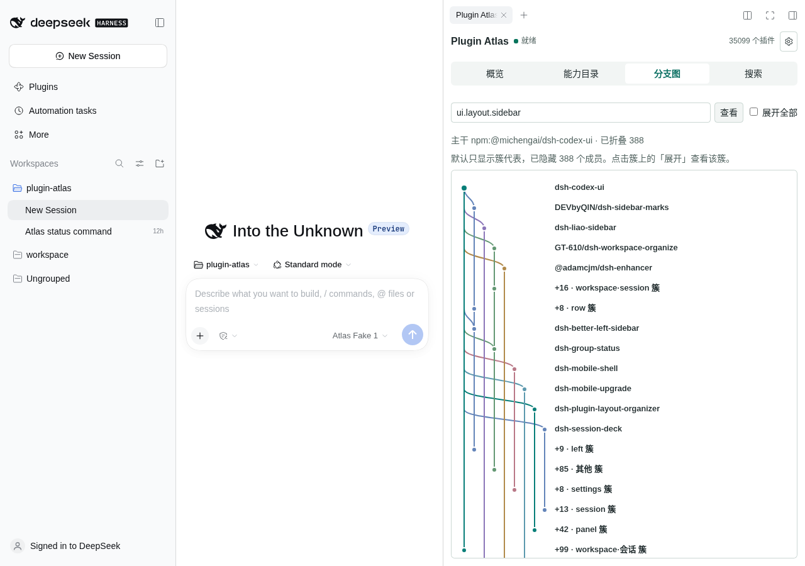
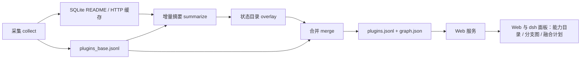

# Plugin Atlas

Plugin Atlas maps the DeepSeek Harness (dsh) plugin ecosystem. It collects plugins from public sources and organizes them into a navigable capability graph, with local search and a dsh sidebar.


*Web 能力目录：分类树与节点能力。*


*Web 融合计划：代表、基底与吸收项。*


*Web 大家族分支图。*


*Web 小家族分支图。*


*Web 暗色主题分支图。*


*dsh 右侧栏分支图。*

## 功能

Plugin Atlas 从 awesome-dsh-plugin 索引、npm 的 `dsh-plugin` 和 `cordis-plugin` 关键词、dsh 官方按需目录、Blue-Whale-Harness 的 `repos.txt` 和 GitHub 搜索六个来源采集插件，组织成分类 → 分支 → 插件的能力图谱。

Web 默认打开「能力目录」，可切换「分支图」；dsh 右侧栏也提供这两个视图。目录详情展示界面、工具及其他能力、相对同级的独有和缺失能力，以及可用的分类能力全集。例如 `ui`（UI 增强）→ `ui.layout`（布局与面板组织）→ `ui.layout.sidebar`（侧边栏与会话组织）。插件详情还可查看 README。「分叉族」详情展示代表、计划状态和融合计划。

分支图支持能力族和 `dup:` 重复关系族。布局按时间排序后把父节点提到子节点之前，每行一个节点，分叉只向下延伸。第 0 道是主干，其余轨道按分叉顺序复用最左侧空闲泳道；默认只显示聚类代表，折叠簇以「+N · 名称 簇」标出。轨道宽 16px，边为三次贝塞尔 S 曲线（2px、圆角端点），建议合并边使用相同曲线的虚线。主干与各泳道使用 `light-dark()` 配色（浅色主干为 `#087e78`）。节点的新增、减少和独有能力相对父节点或聚类代表计算。Web 名称列宽为 `clamp(280px, 25vw, 320px)`，单行省略；点击节点可打开详情抽屉。

融合计划按能力覆盖、热度、最佳实现和近期程度选择最多三个代表，以首个代表为基底，列出补充能力、冲突和迁移步骤。计划保存在状态目录 `plans/`；成员、README 哈希、版本或能力变化会使计划过期。`/atlas plans refresh` 增量刷新过期计划；定时刷新只标记受影响计划并预演树同步，不自动生成计划。

搜索使用 SQLite FTS5 trigram 全文索引和 transformers.js MiniLM 语义索引；模型不可用或向量未完成时降级为 TF-IDF，页面和 `/api/status` 显示实际后端。`github_only` 记录默认隐藏，可通过开关包含；疑似无关记录标记为 `relevance: "suspect"`，过滤移出的记录保存在 `data/filtered-out.jsonl`，可恢复。

## 数据规模与存储

2026-11-12 运行服务的 `/api/status` 显示：

| 指标 | 数量 |
| --- | ---: |
| 插件记录 / 默认可见 | 35,099 / 14,757 |
| `github_only` / 疑似无关 / 已过滤 | 20,342 / 113 / 38 |
| 图谱节点 / 边 | 35,775 / 43,381 |
| 分类级能力文件 | 24 |
| 索引文档 / 向量 | 74,975 / 74,975 |

该服务的语义后端为 `Xenova/paraphrase-multilingual-MiniLM-L12-v2`。`data/` 不纳入 Git，除 `plugins.jsonl`、`graph.json`、`capabilities/` 等外，还包含 brotli 压缩内容的 `readme-store.sqlite` 和 `raw-store.sqlite`；本机分别约 125 MB 和 9.6 MB。采集通过 npm packument 或 GitHub 原始文件获取 README，HTTP 响应和 README 存入两个 SQLite 库，README 松散副本入库后删除，不长期保存插件仓库的完整检出。`crawler/slim.mjs` 可将旧的 `data/readmes/` 和 `data/raw/` 迁入这些库。



## 安装与运行

使用 Node.js 24（本机验证 v24.22.2）和 npm；插件的 engines 声明 Node.js `>=22`。在仓库根目录安装 Web 依赖并启动：

```bash
(cd web && npm ci)
bash web/start.sh
curl -s localhost:4380/api/status
```

打开 [http://127.0.0.1:4380](http://127.0.0.1:4380)。默认端口为 4380，可用 `PORT` 修改；日志写入 `logs/web.log`，停止使用 `bash web/stop.sh`。没有可用数据时服务回退到 `web/fixtures/`。首次使用语义模型时会下载约 300 MB 到 `web/.models/`。

`web/start.sh` 默认将 Node 堆上限设为 3072 MB，可用 `ATLAS_HEAP_MB` 覆盖。已加载服务常见 RSS 约 1.2–1.5 GB（本轮重载前为 1.33 GB；此前一轮在新进程上热启动后常驻约 1.51 GB，峰值约 1.46–1.63 GB）。本轮在已加载模型的长期进程上执行 `POST /api/reload` 约 9 秒返回，返回时约 1.47 GB，随后因新旧快照重叠一度超过 3 GB，约一分钟后回落至约 1.9 GB，请预留余量。这 9 秒是已建索引数据的热重载，并非首次冷启动（首次还需下载约 300 MB 语义模型）。

历史数据可从 [Release v0.1.0](https://github.com/Trangle/plugin-atlas/releases/tag/v0.1.0) 获取；旧包中的松散 README 和原始缓存可用 `crawler/slim.mjs` 迁移到当前 SQLite 存储。数据更新及迁移细节见 [crawler/README.md](crawler/README.md)，数据格式见 [CONTRACT.md](CONTRACT.md)。已有服务可用 `curl -X POST localhost:4380/api/reload` 重载。

## dsh 插件与流水线

`dsh-plugin/` 是 `dsh-plugin-atlas` 0.3.0 组合包。启动服务后，在仓库根目录安装：

```bash
dsh plugin --profile web add "file:$(pwd)/dsh-plugin"
dsh plugin --profile web list --depth 0
dsh --profile web --dump-config | grep -A3 plugin-atlas
```

`file:` 是复制安装，修改插件后需先用 `dsh plugin --profile web remove dsh-plugin-atlas` 卸载再添加。配置、模型后端及完整参数细节见 [dsh-plugin/README.md](dsh-plugin/README.md)。

- **采 collect**：`/atlas update` 增量采集，可合并已有 overlay。
- **提 extract**：`/atlas summarize --incremental` 根据 README 哈希和版本提取变更，默认只写状态目录 overlay。
- **召 recall**：`/atlas search` 或 `/atlas <关键词>` 使用本地服务混合搜索，服务不可用时退回本地全文搜索。
- **比 compare**：`/atlas compare` 比较同类插件、能力和疑似重复项。
- **更 update**：`/atlas merge` 合并 overlay，执行去重、相关性处理和能力刷新并重载；`/atlas refresh` 串联采集、增量摘要和合并。

update、refresh、merge 默认预览，显式 `--apply` 或工具参数 `apply=true` 才写入；`--dry-run` 优先。summarize 默认写状态目录，`--dry-run` 预览。树同步写入生产数据需同时指定 `--apply --allow-production`（工具为 `apply=true`、`allow_production=true`）；可通过 history 查看备份并用 rollback 恢复。单次 token 预算默认 20,000，累计默认上限 100,000，mock 用量不计入上限。

### 命令

| 命令 | 作用 |
| --- | --- |
| `/atlas update [--apply] [--offline] [--skip-github]` | 采集并合并已有 overlay |
| `/atlas refresh [--apply] [--limit N] [--backend mock]` | 采集、摘要、合并 |
| `/atlas summarize --incremental [--limit N] [--ids a,b] [--dry-run] [--backend mock\|llm] [--budget N] [--concurrency N] [--resume id] [--force] [--include-filtered]` | 增量摘要 |
| `/atlas merge [--apply] [--dry-run] [--all]` | 合并 overlay 并刷新 |
| `/atlas tree [节点或关键词] [--depth N] [--caps]` | 查看树和能力 |
| `/atlas tree find <关键词>` | 定位节点 |
| `/atlas tree sync [--dry-run] [--apply] [--allow-production] [--limit N]` | 预演或同步树 |
| `/atlas tree rollback [stamp]`、`/atlas tree history` | 恢复备份、查看历史 |
| `/atlas families [分支] [--stale]` | 查看族和计划状态 |
| `/atlas plan <族或分支或插件> [--refresh] [--dry-run] [--backend mock\|llm] [--budget N]` | 生成融合计划 |
| `/atlas plans refresh [--limit N] [--concurrency N] [--dry-run] [--backend mock\|llm] [--budget N] [--resume id]` | 刷新过期计划 |
| `/atlas status` | 查看状态 |
| `/atlas compare <id...>` 或 `/atlas compare --branch <id>` | 比较插件 |
| `/atlas service start\|stop\|reload\|status` | 管理本地服务 |
| `/atlas search <关键词>` 或 `/atlas <关键词>` | 搜索 |
| `/atlas-open` | 显示网页地址 |

工具包括 `plugin_atlas_search`、`plugin_atlas_node`、`plugin_atlas_status`、`plugin_atlas_update`、`plugin_atlas_refresh`、`plugin_atlas_summarize`、`plugin_atlas_merge`、`plugin_atlas_pipeline_status`、`plugin_atlas_compare`、`plugin_atlas_service`、`plugin_atlas_tree`、`plugin_atlas_tree_find`、`plugin_atlas_tree_sync`、`plugin_atlas_tree_rollback`、`plugin_atlas_families`、`plugin_atlas_plan`、`plugin_atlas_plans_refresh`。工具参数使用下划线，如 `dry_run`、`skip_github`、`allow_production`。计划工具默认预演；命令 `/atlas plan` 使用 `--dry-run` 指定预演。

## 目录与测试

```text
crawler/             采集、分析、能力生成和存储迁移
web/                 本地服务、前端、测试及启动脚本
dsh-plugin/          dsh 插件、流水线与右侧栏
docs/images/         README 图片
data/                本地数据及 SQLite 存储（不入 Git）
CONTRACT.md          数据契约
```

测试可运行 `(cd web && node test.mjs)` 和 `(cd dsh-plugin && npm install && npm run build && npm test)`。数据来源为公开市场、npm 和 GitHub；模型生成的摘要、分类和能力判断可能有误或过时，请以插件原始仓库为准。插件版权归各自作者，README 原文用于索引展示。

MIT，见 [LICENSE](LICENSE)。
